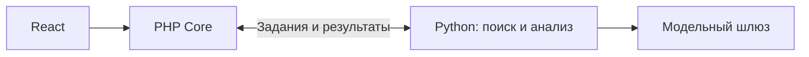

# Устройство проекта

Один репозиторий, три части с разными владельцами:

- `apps/web` — React-интерфейс. Node собирает файлы, nginx отдаёт их браузеру.
- `apps/core` — место для PHP-ядра, которое реализует Backend. Сейчас здесь описание.
- `apps/intelligence` — наша Python-часть: документы, поиск и анализ. Пока реализованы адаптеры моделей и учёт расходов.

## Как части будут связаны

PHP хранит компании, проверяет доступ, создаёт задания и сохраняет итоговый результат. Python получает разрешённые данные, выполняет анализ и возвращает ответ с основаниями. Формат обмена согласуется в [contracts](../contracts/README.md).

Эту связь ещё нужно реализовать. Текущий Docker запускает статический веб-интерфейс; Python CLI запускается отдельной командой. Node backend в рабочей схеме отсутствует. До подключения PHP запросы `/api/` получают `503`, а соответствующие действия в интерфейсе отключены.

Подробности: [компоненты](modules.md), [запуск](development.md), [план задач](backlog.md). Прежние технические планы сохранены в [reference](reference/architecture-details.md).
