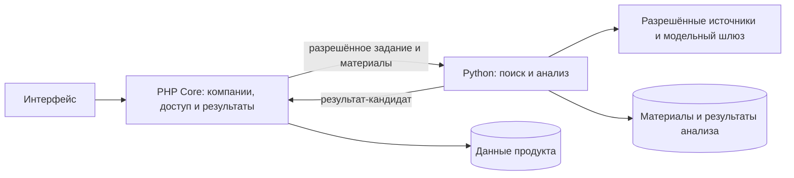

# Архитектура бизнес-контекста

## Зачем нужен продукт

Сервис помогает руководителю понять, как внешние события могут повлиять на конкретную компанию. В ответе должны быть видны источники, позиция банка, вывод модели и неизвестные данные. Если оснований недостаточно, это нужно показать прямо.

## Что работает сейчас

`apps/prototype` — единственное приложение с пользовательским интерфейсом. В нём находятся React-интерфейс, Node Worker и демонстрационные правила. Worker читает две RSS-ленты Банка России и поддерживает ограниченный импорт HTML. Данные браузера хранятся в `localStorage`. Это интерактивный прототип, а не подключённая банковская система.

`apps/intelligence` — отдельная программа на Python: адаптеры к разрешённым модельным шлюзам, командная строка и локальный учёт расходов. Она умеет сделать отдельный вызов модели по явной команде. Полный сбор документов, поиск, анализ и обработка заданий ещё не реализованы.

`apps/core/README.md` описывает план Symfony/PHP Core. Рабочего PHP-приложения пока нет. Здесь должно находиться бизнес-состояние: компании и их контекст, права, задания на анализ и опубликованные результаты.

## Предлагаемое устройство MVP

План продуктовой редакции v3: пользовательский интерфейс передаёт запрос в Core; Core хранит данные компании и решает, кто может их читать; Python получает разрешённые материалы, выполняет анализ и возвращает результат-кандидат. Core проверяет результат и сохраняет его для показа. Интерфейс читает сохранённый результат у Core.

Эта схема показывает направление развития; сейчас она не собрана в единый запуск. React-интерфейс пока часть `apps/prototype`. Отдельного каталога `apps/web` и обязательного Node BFF нет. Текущий Node Worker остаётся частью прототипа. Перенос UI в отдельное приложение — будущая задача.

Основные границы просты: Core отвечает за права, пользовательские изменения и окончательную публикацию; Python отвечает за поиск и подготовку анализа; интерфейс показывает данные и отправляет действия пользователя. Python не должен напрямую менять бизнес-данные Core. Связь приложений согласуется через примеры и схемы в [`contracts/README.md`](../contracts/README.md).

## Путь одного запроса в будущем MVP

1. Пользователь выбирает компанию и просит оценить новое событие.
2. Core проверяет доступ и сохраняет запрос как задание.
3. Python получает от Core только разрешённые материалы и выполняет поиск и анализ.
4. Python возвращает результат со ссылками на основания и используемыми версиями данных.
5. Core проверяет и сохраняет результат; интерфейс показывает его и использует ссылки для чтения подробностей.

Состав модулей описан в [документе о компонентах](modules.md), команды разработки — в [руководстве по запуску](development.md). Технические детали целевой схемы и её ограничений собраны в [расширенном описании](reference/architecture-details.md).
