# Архитектура проекта

В репозитории есть React demo UI и развиваемая Python AI/Data часть. Symfony Core — внешний компонент: в `apps/core` пока нет рабочей реализации. Протоколы и fixture stand позволяют проверять совместимость, но не подменяют пользовательский PHP backend.

```mermaid
flowchart LR
    User[Пользователь] --> UI[React UI]
    UI --> PHP[Symfony Core: права и бизнес-состояние]
    PHP -->|ai-job-v1 / source policy snapshot| Worker[Python CoreClient + Worker]
    Worker -->|claim / heartbeat / ai-result-v1| PHP
    Worker --> Workflow[Python DataWorkflow]
    Workflow --> Collect[Source grants / bounded collector]
    Collect --> Corpus[CorpusStore + private raw receipts]
    Corpus --> Events[Events / claims / shared impact package]
    Events --> Research[Scoped retrieval / graph / period / watches]
    Research --> Analysts[Baseline or approved analyst config]
    Analysts --> LLM[Explicitly configured model, if classification + budget allow]
    Research --> Result[Candidate / coverage / versions]
    Analysts --> Result
    Result --> PHP
```

## Владение данными

Core — источник истины для principals, membership/permissions, company profiles, source catalog and grants, source policy versions, jobs/leases, decisions и опубликованных business revisions. Frontend вызывает Core, а не внутренний Python endpoint. Пользовательское скрытие новости не меняет analytics policy; компания-исключение source/publisher/document требует Core permission и новой policy version.

Python хранит технические AI/Data records: неизменяемые документы и revisions, сырые bytes/hash receipts, evidence, event artifacts, impact packages, analyst configs, workflow stages, budget ledger и result outbox. Корпус и конфигурации находятся в локальном SQLite/state directory; private raw blobs tenant-isolated. Это не общий банковский PostgreSQL и не таблицы Core.

Source PolicySnapshot приходит от Core на каждую задачу. Collector проверяет tenant, даты, enabled source, exclusions, HTTPS, публичные DNS addresses с IP pinning/TLS, allowlisted redirects, limits, ETag/backoff. Probe — одноразовая проверка URL; он не сохраняет user subscription. Collector поддерживает RSS/Atom, HTML, PDF и статическое JSON dot-path mapping, без произвольного crawler. Оригинал хранится отдельно от нормализованного текста и не меняет class из-за текста материала.

## Поток AI/Data

1. Core проверяет право пользователя, собирает snapshots и создаёт durable job со scope, versions, deadline, budget и generation.
2. Worker получает `ai-job-v1`, запускает workflow с heartbeat/checkpoints, проверяет lease/deadline/versions и ставит точное сообщение в durable outbox.
3. Collector читает только разрешённый source snapshot. Corpus сохраняет raw receipt, нормализованные ревизии и provenance. Без публикационной даты материал остаётся pending, а не получает текущую дату.
4. EventStore объединяет повторные публикации, ведёт source origins/revisions и claim metadata; shared impact package можно применить к нескольким company snapshots. Similarity и упоминание в платеже не доказывают независимость источника или коммерческую связь.
5. Research ограничен разрешёнными document refs, as-of/knowledge cutoff, профилем и предоставленным графом. Периодные метрики рассчитываются детерминированно. Watch eval применяет заданные человеком/Core условия к наблюдениям.
6. Логические роли researcher/analyst/critic делят один scope и budget pipeline. Это не обязательный набор отдельных agent services. При наличии разрешённой классификации и явного budget вызывается настроенный provider; confidential input блокирует внешний call.
7. Worker передаёт `ai-result-v1`. Core повторно проверяет cancel, lease generation, versions, scope и signature; только Core публикует или отклоняет ситуацию.

Python cache не является доказательством получения результата Core. Core прикладывает точный `published_assessments` proof на следующую работу; без него Python возвращает сохранённый candidate с `publication_revision_required=true`, а Core дедуплицирует signature, чтобы не потерять первую публикацию или не создать revision повторно.

## Запуск и масштабирование

FastAPI предоставляет внутренний сервисный API; CLI может напрямую исполнить DataTask для локальной проверки. В рабочем пути Core владеет очередью, scheduler, user-facing progress, cancellation и notifications. Fixture-only Core stand привязан к loopback и запускается с явным `--fixture-mode`; он тестирует обычные worker routes и SQLite state, но не реализует PHP authorization/SSO/UI.

Для текущих контрактов не требуются Kafka, Redis или vector database. SQLite позволяет повторить локальные состояния и проверить revisions/cache/outbox, но не объявляется production multi-node persistence. Научная/экспертная точность, банковские source rights, реальные CSV/PDF и бизнес-приёмка требуют внешних данных.

Подробнее: [подключение Backend/Frontend](ai-integration.md), [процесс AI/Data](ai-process.md), [матрица готовности](ai-scope-and-readiness.md), [контракты](../contracts/intelligence/README.md), [локальная разработка](development.md), [backlog](backlog.md), [live проверки](ai-live-checks.md).
