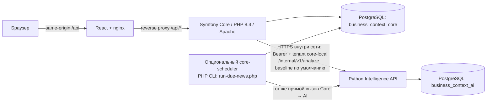

# Архитектура

Сейчас это локально запускаемый продуктовый срез из трёх приложений: React UI, Symfony Core и Python Intelligence. Compose соединяет их для разработки и демонстрации; компоненты пока не являются банковской производственной платформой.

## Runtime сейчас

Web обслуживает статические файлы из непривилегированного nginx. `/api/` проксируется в Core. Core — PHP 8.4 + Symfony 7.4, Apache слушает 8080 в контейнере, локальный порт по умолчанию 8090. Python API слушает 8081 и доступен на loopback в локальном Compose. PostgreSQL 17.11 содержит две отдельные базы: `business_context_core` и `business_context_ai`; Core и AI используют собственные app/migration роли. Это изоляция по базам/ролям внутри одного экземпляра PostgreSQL, а не независимые кластеры.

Compose штатно поднимает `core-migrate` (схема и demo seed), `intelligence-migrate`, генератор внутреннего service bearer, Core, Intelligence API и web. Секрет приложения PHP и PHP session-файлы лежат в отдельных volumes. Service bearer генерируется однократно и передаётся Core/AI через общий read-only volume; настройка `INTELLIGENCE_SERVICE_TOKEN`, если задана при первом создании, служит seed токена. Ключи OpenRouter/хакатонного шлюза передаются только Python.

## Фактические пользовательские сценарии

- Core login проверяет email/password и выставляет HTTP-only, SameSite=Strict cookie с 30-минутным idle timeout. Core ограничивает список компаний членством пользователя и проверяет роль для операций записи. Демо-логин создан только для локального запуска.
- UI после авторизации читает компании, контекст, метрики, dashboard и новости из Core. Контекст записывается с `expectedVersion`; конфликт возвращает `409`. Новости в UI — чтение источников, документов, запусков и уже сохранённой оценки; UI не запускает Python analysis job.
- При вызове `php bin/run-news.php COMPANY_ID` Core собирает текущие контекст, разрешённые источники, их policy revision и `tenant_id` конфигурации. Core вызывает Python `POST /internal/v1/analyze` с внутренним Bearer; API допускает tenant `core-local` в Compose-конфигурации. Базовый режим `baseline` не обращается к LLM. Core сверяет версии перед сохранением news-run/result.
- При `--profile scheduler` контейнер PHP CLI циклически вызывает существующий `bin/run-due-news.php`. Он выбирает компании с включёнными источниками и не запускает их чаще раза в час. Пустой demo seed не содержит источников, поэтому перед сбором оператор должен добавить разрешённый источник.

## Что не следует принимать за реализованное

В Core пока нет общей таблицы/очереди пользовательских Analysis Jobs, атомарного claim, heartbeat/lease, generation fencing и принятия Python результата через result endpoint. Текущий PHP news runner — ограниченная интеграция прямого HTTP вызова; она не использует Python worker как Core job executor. Не утверждать, что UI инициирует анализ, что SSE/outbox есть, или что состоялся полный job lifecycle. Python `intelligence-worker` и fixture Core Stand — отдельный контрактный/разработческий путь и не подключены к этому продуктовому Core queue.

`CORE_INTELLIGENCE_TENANT_ID=core-local` — локальный deployment scope для внутреннего API; это не tenant пользователя, переданный браузером. Пользовательская изоляция Core сейчас основана на membership к company ID. В промышленном deployment отдельно нужны проверенные SSO/identity, tenant-модель, deployment secrets, сеть/сертификаты, audit/retention и оценка безопасности. Наличие Postgres roles и защищённых cookie не равно production security approval.

## Следующий целевой шаг

Добавить Core-owned durable jobs lifecycle с idempotent command, transactional outbox, bounded retries, claim/heartbeat/result/failure, lease generation и проверкой контекстных/source versions. После этого подключить AI worker только через этот контракт и сделать UI отображение статусов/оценок. До завершения этого шага прямой `run-news.php` остаётся отдельным ограниченным потоком. Подробности реализации и локального запуска — [Symfony](symfony-integration.md), [AI integration](ai-integration.md), [разработка](development.md), [Docker](../infra/README.md).
