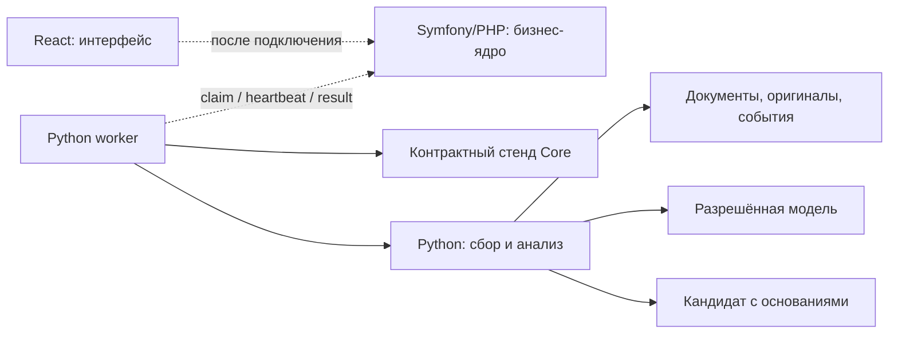

# Архитектура

Проект состоит из трёх частей: React-интерфейса, бизнес-ядра Symfony/PHP и отдельного Python-модуля анализа данных. В репозитории работают интерфейс на учебных данных и Python. PHP ещё не реализован; его протокол проверяется через отдельный контрактный стенд.

## Что работает сейчас

- **React/nginx:** интерфейс и локальное состояние браузера. Node.js нужен для сборки и тестов. Пользовательские действия пока не запускают Python.
- **Python CLI/API/worker:** сбор материалов, документы, события, общий разбор, анализ компаний, периоды и наблюдения, настройки аналитика и турнир.
- **Контрактный стенд Core:** проверка получения задания, продления lease и доставки результата. Он не предоставляет пользовательские права и не заменяет Symfony.

## Подключение компонентов

Пунктир обозначает ещё не подключённый PHP-контур. В рабочей системе интерфейс обращается к Core. Python worker забирает задания у Core и возвращает кандидатов, а не публикует ситуации самостоятельно.

## Кто владеет данными

| Core | Python |
|---|---|
| Пользователи, организации и права | Получение разрешённых материалов |
| Профиль компании и ответы на уточнения | Документы, версии, оригиналы и поиск |
| Каталог источников, настройки и политика | События, общий разбор и персональный анализ |
| Расписание, задания, отмена и публикация | Настройки аналитика, оценки и турнир |
| Бизнес-статусы и доставка в интерфейс | Журнал этапов, расходы и очередь отправки результата |

Core передаёт неизменяемый снимок контекста и политики. Python не читает и не изменяет бизнес-таблицы Core. Личное скрытие новости не исключает её из анализа компании; для исключения основания Core выдаёт новую версию политики.

## Путь данных

1. Core создаёт задание с разрешёнными компаниями и источниками, версиями, сроком и бюджетом.
2. Worker получает задание и продлевает lease — ограниченное по времени право его выполнять. Отмена или потеря lease останавливает следующие этапы.
3. Collector получает RSS/Atom, HTML, PDF или JSON по указанным правилам. Проверяются адреса, ограничения размера и времени, исключения и срок следующего опроса. Probe источника возвращает предварительный просмотр, а не создаёт подписку.
4. Корпус сохраняет оригинал отдельно от нормализованного текста. Публикации получают версии и точные фрагменты. Перепечатки объединяются в события, общий разбор используется для нескольких компаний.
5. Поиск работает в разрешённом корпусе. Влияние оценивается по переданным фактам и зависимостям компании. Платёж и принадлежность группе не доказывают поставку.
6. Исследователь, аналитик и критик работают в общем лимите. Код проверяет формат, ссылки и условия использования данных; смысловая правильность требует отдельной оценки.
7. Worker передаёт `ai-result-v1`. Core проверяет актуальность версий и lease, устраняет повтор и принимает решение о публикации.

Локальный кеш не доказывает, что Core получил результат. Для повторной проверки Core передаёт `published_assessments` — подписи уже опубликованных оценок. Без подтверждения Python повторно предлагает сохранённого кандидата, а Core устраняет дубликат.

## Хранение и запуск

Рабочие данные Python Intelligence хранятся в отдельной PostgreSQL-базе `business_context_ai`; миграции создают компонентные схемы и изоляцию строк через `store_key`/RLS. Core владеет профилем, правами, очередью jobs и публикацией в своей стороне. Наличие PostgreSQL для Python не подключает PHP Core и не меняет API-контракт.

Файлы и raw receipts остаются в private файловом хранилище на `intelligence-state`; PostgreSQL хранит ссылки, метаданные и версии. База PostgreSQL живёт в отдельном volume. SQLite используется в миграционном импортере как источник только для чтения и в SQLite-backed Core Stand как тестовая реализация контракта. Stand не является рабочей базой Intelligence или PHP Core.

`intelligence_app` — рабочая роль без привилегий владельца и обхода RLS; `intelligence_migrator` отдельно применяет миграции с ролью `intelligence_owner`. Пул PostgreSQL ограничен четырьмя соединениями на процесс по умолчанию. Команды запуска, роли, namespace и импорт описаны в [руководстве PostgreSQL](postgresql.md). Kafka, Redis и векторная база для текущего потока не требуются. Банковская авторизация, SSE, многосерверное развёртывание и эксплуатационные гарантии ещё не подключены.

[Интеграция](ai-integration.md) · [Контракты](../contracts/intelligence/README.md) · [Запуск](development.md) · [Готовность](ai-scope-and-readiness.md) · [Проверки](ai-live-checks.md)
