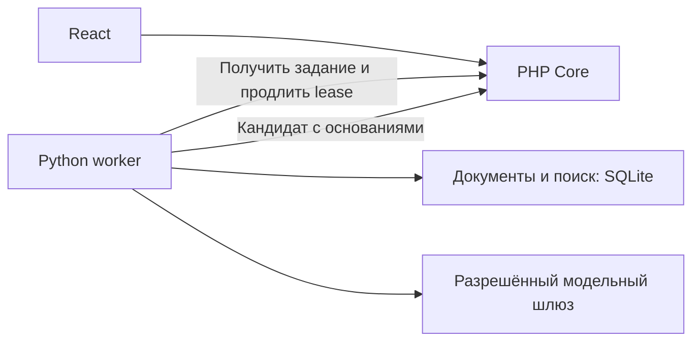

# Устройство проекта

Один репозиторий, три части:

- `apps/web` — React-интерфейс; Node собирает файлы, nginx отдаёт их браузеру.
- `apps/core` — PHP-ядро, которое создаёт Backend; сейчас здесь описание.
- `apps/intelligence` — работающая Python-часть: материалы, поиск, анализ и получение заданий.

PHP хранит компании, проверяет пользовательский доступ, создаёт задания и публикует результат. Python работает с выданным снимком данных, сохраняет свои документы/артефакты и возвращает кандидата. Он не пишет в базу PHP и не выполняет действия за клиента.

В Python есть внутренний FastAPI и отдельная команда worker. Они используют общий код анализа и могут работать с общими файлами SQLite. Для стенда этого достаточно; PostgreSQL/объектное хранилище — дальнейшее расширение при необходимости. Kafka, Redis и векторная база не требуются для текущего запуска.

Python-сторона обмена и [контракты](../contracts/intelligence/README.md) реализованы и проверяются с подставным Core. Настоящий PHP ещё не подключён. До его появления веб использует учебные данные, `/api/` отвечает `503`.

Подробнее: [компоненты](modules.md), [запуск](development.md), [ближайшие задачи](backlog.md).
