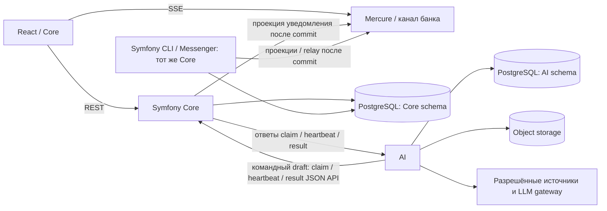

> Архив раннего планирования. Содержит сведения о прежней структуре и удалённом Node backend; не использовать как текущую инструкцию. См. [архитектуру](../architecture.md), [запуск](../development.md) и [готовность](../ai-scope-and-readiness.md).

# Архитектура бизнес-контекста

## Цель и состояние

Модуль связывает внешние события и аналитику Альфа-Банка с контекстом и зависимостями компании. Он объясняет, что известно, что является позицией банка, а что — гипотезой модели, предлагает следующую проверку и пересматривает оценку при изменении существенных условий. Хакатонный путь должен работать на новой для демосценария новости и нескольких ролях ЛПР крупной компании; это не обещание промышленного охвата.

**Текущий код — сохранённый прототип.** Сохранённый `apps/web` — React/Core Components, Node Worker и JavaScript-ядро. Браузер хранит состояние в `localStorage`; Worker имеет `GET /api/status`, `GET /api/news`, `POST /api/import`, `POST /api/analyze`. Есть две RSS-ленты ЦБ, ограниченный HTML import и локальный режим правил. Без настроенного ключа `POST /api/analyze` отвечает HTTP 400; интерфейсный расчётный режим исполняется отдельно. В текущем UI-прототипе нет Symfony, подключённого Python сервиса, PostgreSQL jobs, банковского SSO/ACL или SSE. Отдельно реализован Python-слой модельных провайдеров и локального бюджета в `apps/intelligence`; [запуск и границы](../llm-providers.md). README сообщает о трёх обезличенных CSV-строках в seed, но их происхождение по оригинальному CSV здесь не подтверждалось. Node API остаётся частью сохранённого прототипа и не владеет новой MVP-архитектурой.

**Запланированный хакатонный MVP:** React + Core Components → Symfony 7.4 / PHP 8.4 Core → PostgreSQL и объектное хранилище, Python FastAPI AI/Data service, SSE-hub (Mercure либо штатный канал), разрешённый модельный шлюз. Symfony — единственный владелец пользовательских команд, авторизации, бизнес-состояния, jobs и опубликованных оценок. Node BFF не обязателен; использовать существующий банковский gateway/BFF только если это требует контракт оболочки. Текущий прототип не переписывать незаметно под новую схему и не описывать Symfony как уже реализованный runtime.

**Версии.** В v3 предложены Symfony 7.4 LTS и PHP 8.4. Symfony 7.4 допускает PHP от 8.2, а поддержка безопасности заявлена до ноября 2029 ([официальный график выпусков](https://symfony.com/releases/7.4)); это совместимость, не утверждение о допуске PHP в банк. PHP 8.4 — предлагаемая ветка. Точный патч и пакеты закрепить в `composer.lock` при создании приложения. PHP допуск, образ, расширения, SSO, CI/CD и эксплуатационный владелец согласуются с платформой до банковского пилота. Отдельной Java/Spring реализации в целевой схеме нет.

## Компоненты и владение

Symfony modular monolith состоит из Access/Company, Source Policy, Situations, Analysis Jobs, Delivery/Read и Bank Integration modules (product v3, p.14). Их внутренние границы — модули одного Core, не микросервисы. Python — отдельное приложение из пула ingest/parse/search/analysis workers (pp.12–13). PHP CLI workers/Messenger обслуживают короткие Core-задачи, например read projections, outbox relay и уведомления; долгий Python-анализ выполняется через lease API. SSE-hub держит соединения вне PHP-FPM и не владеет бизнес-состоянием (pp.15–19, 24).

Можно начать с одного PostgreSQL-кластера, но с отдельными схемами и DB roles. Core владеет tenant/membership adapters, компаниями и версиями контекста, source policy, опубликованными ситуациями/assessment revisions, пользовательскими решениями, jobs, идемпотентностью, outbox/inbox, read models и журналом уведомлений. Python владеет ingest, документами/их ревизиями, извлечёнными утверждениями, доказательными фрагментами и поисковым индексом. Core хранит evidence snapshots/references, нужные для воспроизведения уже опубликованного assessment. Межсервисных SQL joins, FK и записи Python в таблицы Core нет; объектные ссылки выдаются только сервисной идентичности. PostgreSQL RLS — дополнительный слой, а не замена API ACL.

## Поток анализа и публикации

1. React отправляет команду Symfony Core с `Idempotency-Key`, expected revision/версией входов и `request_id`. Core определяет tenant из удостоверенного контекста, проверяет членство/право на компанию, quota и policy. `tenant_id` из body не задаёт доступ.
2. В одной Core-транзакции создаются job, idempotency record и outbox record. Только после commit возвращается `202 Accepted` и `job_id`.
3. Python worker получает job через внутренний claim API Core. Core короткой транзакцией резервирует due job и возвращает lease, generation, deadline и версии входов. Python не читает Core schema/jobs напрямую. Он получает минимальный разрешённый context/source snapshot, продлевает lease и сохраняет промежуточные артефакты в своей схеме AI и объектном хранилище.
4. Ограниченная state machine Python планирует шаги, обращается только к allowlist tools и выполняет поиск/расчёты/LLM вне HTTP-запроса пользователя. Внешние факты, позиция Альфа-Банка, вывод модели, рекомендации, допущения и unknowns сохраняются раздельно. Каждый вывод ссылается на точную ревизию/фрагмент или помечается гипотезой/неизвестным.
5. Python передаёт кандидат через result API с `job_id`, `lease_generation`, `input_versions`, schema version и ссылками на артефакты. Symfony проверяет scope, право, отмену, схему, ссылки, версии и fencing. Устаревший результат получает `superseded` и не публикуется. Повтор того же `message_id` и payload возвращает ранее выданный ack даже после закрытия lease; payload с тем же ID, но иным содержимым, и новый результат от worker со старым `lease_generation` отклоняются с `409`.
6. Core атомарно сохраняет принятую assessment revision и outbox notification. Короткая PHP/Messenger-задача применяет projection и журнал уведомлений; только после commit событие публикуется в SSE-hub. UI получает минимум данных (`event_id/cursor`, object id, revision) и читает готовое состояние через REST. Polling — резерв.

## Jobs, доставка и повторы

У Python analysis job один владелец состояния и повторов: Core job runtime с `run_after`, lease/heartbeat, `lease_generation`, отменой, попыткой и deadline. Claim/heartbeat/result — внутренний версионированный JSON API, предлагаемые маршруты перечислены в [`contracts/README.md`](../../contracts/README.md); это командный draft, не заданный в PDF. Идемпотентность команды ограничена tenant + инициатор + операция: тот же key/payload возвращает прежнюю job, другой payload даёт `409`. At-least-once delivery допускается; inbox/idempotent handlers подавляют повторный эффект. Поздний worker со старым `lease_generation` не публикует результат.

Symfony Messenger с начальным Doctrine transport обслуживает отдельные короткие PHP-задачи и их failure transport. Он не конкурирует с Core за попытки Python jobs. Нет второй очереди Celery для тех же analysis jobs. Сначала claim API поверх Core storage; Kafka — транспортный адаптер только при подтверждённом контракте/потребности. Messenger retry и Python job retry настраиваются раздельно, без вложенных скрытых retries; full jitter не равен встроенному Messenger jitter. Если нужна именно full jitter, v3 предлагает собственную `RetryStrategyInterface`; три попытки всего означают `max_retries=2`. Документация Symfony отдельно говорит, что `RecoverableMessageHandlingException` обходит `max_retries` и потому не годится для ограниченного retry policy [Messenger docs](https://symfony.com/doc/7.4/messenger.html).

## Поиск и условные зависимости

В MVP и стенде — лексический поиск. Векторный/hybrid search и reranker вводятся только после подтверждения разрешённых моделей/embeddings, ACL-фильтров и измеренного выигрыша; Qdrant — условное расширение пилота, а не обязательная зависимость. Kafka, Redis, read replicas и отдельные БД — по контракту/измерениям. PostgreSQL jobs/outbox, S3-совместимое object storage и SSE-hub входят в целевую первую поставку v3; их доступность и лимиты ещё должны быть согласованы. Не выдумывать доступ к AlfaGen, CSV, банковскому SSO или внешним архивам.

## Безопасность и свежесть

Core проверяет ACL для чтения, записи, job, экспорта, подписки и вложения. Роль влияет на порядок показа, не заменяет полномочие. Tenant/company scope применяется к cache keys, cursor, search и SSE topics; закрытые evidence не помещаются в публичный topic. Для SSE: private topics и короткий topic-scoped доступ; JWT сам по себе не даёт немедленного отзыва. До пилота проверяется инвалидация на gateway/hub; если не поддерживается, только минимальный обезличенный сигнал перечитать API и согласованное окно отзыва.

Источники и документы имеют provenance, даты `published_at`, `event_time`, `fetched_at`, content hash и revisions. Новая публикация сначала проверяется на исправление/дубль/перепечатку, первоисточник, дату и отношение к зависимостям. Существенное изменение или исключение основания создаёт адресный пересчёт. Без изменений новая assessment revision не появляется. Недоступность источника отображается как неполное покрытие и старая дата проверки, не как отсутствие риска. Сохранять факты компании отдельно от банковской аналитики, модели и пользовательских допущений; прогноз банка не превращать в факт.

## MVP и пилот

Для MVP из v3: Symfony Core + PHP CLI workers/Scheduler/Messenger + Python FastAPI/workers + PostgreSQL jobs/outbox + объектное хранилище + SSE-hub, React/Core, lexical search, Docker Compose и разрешённый model gateway. Сохранённый Node-прототип остаётся отдельным текущим кодом; отдельный Node backend не нужен. Демо-сессия/согласованный тестовый auth допустимы до банковского SSO, но нужно честно показать границы доступа. Пилот добавляет согласованный SSO/membership, ACL, восстановление/HA, SSE revoke behavior, полный ingest/licensing и критерии нагрузочного/качественного контроля.

Kafka подключается только по контракту; Redis/Qdrant — после измерений и подтверждения доступа. AlfaGen и доступ к исходным CSV не предполагаются. Собственная платформа LLM не нужна. Без доступа к банковской платформе сроки пилота и SLO не обещаются.
